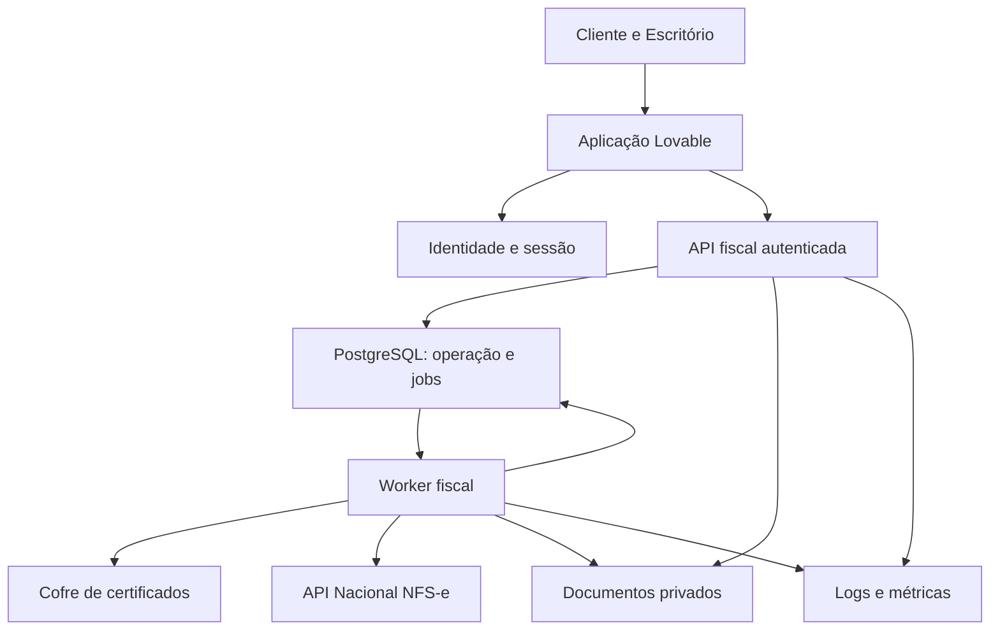

# DESIGN: NFS-e Nacional para Gestoras de Imóveis

> Design técnico proposto para aplicação Lovable com backend fiscal separado. Esta entrega não cria aplicação, banco, projeto Lovable ou infraestrutura.

## Metadata

| Attribute | Value |
|---|---|
| **Feature** | Emissão de NFS-e Nacional para Gestoras de Imóveis |
| **Date** | 2026-10-31 |
| **Author** | SDD Design by RDD |
| **BRAINSTORM** | BRAINSTORM_NFSE_GESTORAS_IMOVEIS.md |
| **DEFINE** | DEFINE_NFSE_GESTORAS_IMOVEIS.md, v0.9 |
| **UX REVIEW** | UX_REVIEW_NFSE_GESTORAS_IMOVEIS.md, v1.0, BLOCKED FOR DESIGN |
| **LLM Prompts** | false |
| **Status** | Draft |
| Base confirmada | Opção 1: aplicativo Lovable com backend seguro separado, resposta do usuário em 31/10/2026 |
| Base proposta | Frontend nativo do projeto Lovable; backend Python em container; PostgreSQL, storage privado e cofre de segredos |
| Código observado | Nenhum repositório ou aplicativo fornecido; caminhos do manifest são propostos |
| Documento complementar | GOVERNANCA_REVIEW_NFSE_GESTORAS_IMOVEIS.md |

### Prontidão e autoridade das decisões

A opção 1 confirma a separação de responsabilidades, sem confirmar fornecedor, linguagem de backend ou hospedagem. A implementação Python e sua estrutura são uma proposta para revisão, não uma escolha anterior do usuário. A documentação oficial do Lovable consultada informa TanStack Start para aplicativos novos; não se pressupõe um projeto legado React/Vite.

O pedido atual autoriza elaborar soluções de Design para os achados de UX. Não é tratado como aceite de todas as recomendações de governança, nem como autorização para modificar o DEFINE e o UX_STANDARD. Os comportamentos M01–M05 estão especificados abaixo; seu fechamento formal depende de incorporação ao DEFINE e reaplicação do gate. O status não é Ready for Build.

**Decisões pendentes para consolidar:**

1. Confirmar a proposta de backend e os serviços de identidade, banco, storage, cofre e hospedagem; alternativamente adequar ao ambiente que o projeto Lovable disponibilizar.
2. Confirmar importação parcial deliberada e salvamento explícito com proteção de troca de contexto, propostos para M02/M03.
3. Validar o contrato fiscal completo por spike em produção restrita: leiaute, assinatura, autenticação, serialização, consulta e interpretação dos retornos.
4. Deliberar individualmente as recomendações de governança. Não impor segunda pessoa aprovadora; AT-007 continua permitindo revisão pelo próprio emitente autorizado.
5. Registrar operações elegíveis, responsável técnico, política de guarda e habilitação das empresas piloto. A aplicação inicia com transmissão bloqueada para contextos não liberados.
6. Criar os comandos reais de verificação no Build; os comandos deste documento são especificações de implementação, ainda não existentes.

## Architecture Overview



O backend fiscal é a autoridade de autorização, elegibilidade, revisão e estado. O navegador não chama a API Nacional, não assina DPS e não recebe certificado ou senha. O processamento interno é assíncrono para recuperação de falhas, ainda que o serviço oficial responda de forma síncrona. Não se presume callback ou webhook oficial.

A API e o worker compartilham a mesma aplicação de domínio e o banco; são dois processos do mesmo serviço, não uma malha de microserviços. Jobs persistidos no PostgreSQL evitam introduzir Redis ou um broker separado no MVP. Identidade, storage e cofre são dependências de infraestrutura com contratos explícitos; seus fornecedores continuam pendentes.

**Evidências técnicas consultadas em 31/10/2026:**

- [FAQ oficial Lovable](https://docs.lovable.dev/introduction/faq): stack de novos projetos e possibilidade de backend por APIs externas.
- [Integração de APIs no Lovable](https://docs.lovable.dev/integrations/any-api): fronteira entre aplicação e integração externa.
- [Documentação atual da NFS-e](https://www.gov.br/nfse/pt-br/biblioteca/documentacao-tecnica/documentacao-atual): catálogo oficial de manuais, esquemas e anexos.
- [Manual consultado do Emissor Público](https://www.gov.br/nfse/pt-br/biblioteca/documentacao-tecnica/documentacao-atual/manual-contribuintes-emissor-publico-api-sistema-nacional-nfs-e.pdf): recepção de DPS, retorno de NFS-e e consulta por identificador da DPS.

Essas referências fundamentam as fronteiras propostas, não certificam a versão de cada contrato em novembro de 2026. O spike deve seguir os arquivos apontados pela página oficial na data da implementação e registrar versão, URL, data e SHA-256; não usar silenciosamente um PDF antigo como contrato definitivo. Nenhuma notícia de obrigatoriedade tributária do Brainstorm foi utilizada como regra operacional.

## Components

| Component | Purpose | Technology / Pattern | Inputs | Outputs | Dependencies |
|---|---|---|---|---|---|
| Aplicação Lovable | Preparar, revisar e acompanhar por empresa | Base nativa gerada; componentes React/TypeScript propostos | Sessão e entradas humanas | Requisições internas e feedback | Identidade, API |
| Identidade | Login e sessão verificáveis | Provedor gerenciado a confirmar; contrato JWT/OIDC proposto | Credenciais via provedor | Identidade verificável | Serviço de identidade |
| API fiscal | Validar, autorizar e persistir comandos | Python/FastAPI proposto | Identidade, empresa, versão, confirmação | Dados e erros tipados | PostgreSQL, storage |
| Domínio | Estados e invariantes | Python Decimal e transições explícitas | Comandos validados | Operação consistente | Repositório |
| Importador | Prévia e criação deliberada de rascunhos | Parser CSV/XLSX no backend | Arquivo e layout | Linhas, totais, pendências | Storage, repositório |
| Revisão | Vincular conferência ao conteúdo exato | Snapshot versionado e hash | Rascunho e parâmetros | Revisão identificada | Domínio, elegibilidade |
| PostgreSQL | Fonte operacional e fila persistente | Transações e unicidade | Comandos | Estado, vínculos e jobs | Infraestrutura a confirmar |
| Worker fiscal | Executar transmissão e reconciliar | Claim com lease e jobs duráveis | Comando persistido | Retorno oficial ou incerteza | Adaptador, cofre, storage |
| Adaptador Nacional | XML, assinatura, HTTP e interpretação | Bibliotecas escolhidas após spike | Snapshot e credencial autorizada | Resultado fiscal normalizado | API Nacional |
| Storage | Origem, DPS e retorno preservados | Objetos privados versionados | Bytes e metadados | Referência e hash | Provedor a confirmar |
| Cofre | Custodiar e liberar uso de certificado | Serviço de segredos e acesso mínimo | Referência de credencial | Material apenas no processo autorizado | Provedor a confirmar |
| Observabilidade | Diagnóstico e correlação | Logs estruturados e métricas | Eventos técnicos | Alertas operacionais | API e worker |

### Superfícies e navegação

| Tela | Conteúdo essencial | Ação principal | Recuperação |
|---|---|---|---|
| Entrada | Login e empresa autorizada | Entrar | Retomar contexto autorizado |
| Início | Nova NFS-e, rascunhos, pendências e histórico recente | Nova NFS-e | Limpar filtros ou abrir pendência |
| Rascunho | Empresa fixa, tomador, operação, valor e campos condicionais | Salvar e revisar | Erros locais sem apagar campos |
| Importação | Empresa de destino, layout e arquivo | Analisar arquivo | Erros de formato acionáveis |
| Prévia | Situação por linha, totais e itens já importados | Criar rascunhos válidos | Corrigir origem e reanalisar |
| Revisão | Empresa/CNPJ, tomador, operação, valor e alertas | Emitir NFS-e | Voltar para corrigir, invalidando revisão |
| Acompanhamento | Estado persistido e identificação da operação | Verificar situação, se incerta | Suporte com código de atendimento |
| Resultado | Confirmação oficial e documento disponível | Visualizar documento | Repetir consulta/download, sem reemitir |
| Acesso negado | Mensagem genérica | Voltar ao contexto autorizado | Novo login se sessão expirada |

Uma ação primária dominante por contexto. Desktop é principal; formulário, revisão e consulta simples funcionam no celular. Tabelas extensas usam detalhe por registro, preservando CNPJ, tomador, operação e valor. Modais devolvem foco ao acionador; erros se associam aos campos e resumo; estados usam texto e sinal adicional; atualizações são anunciadas por região acessível sem capturar foco.

Tokens visuais serão semânticos: superfície, texto, texto secundário, ação, foco, sucesso, atenção e erro. Seus valores são proposta de protótipo, ainda não canônicos. Não impor preto/dourado por memória de marca. Contraste e dimensões serão medidos no Build contra a referência do UX_STANDARD; não se declara conformidade apenas por usar biblioteca.

## Key Decisions

### Decision 1: Separação Lovable e serviço fiscal

| Attribute | Value |
|---|---|
| **Status** | Accepted |
| **Date** | 2026-10-31 |
| **Source** | DEFINE e opção 1 confirmada pelo usuário |

**Context:** A interface precisa ser simples sem custodiar certificados.

**Choice:** Lovable para a experiência; serviço fiscal separado para validação, assinatura e envio.

**Rationale:** Atende à separação explícita já definida.

**Alternatives Rejected:** RPA do portal: fora do escopo. Chamada fiscal pelo navegador: expõe credenciais.

**Consequences:** Exige operação de backend, configuração de origem e integração autenticada.

### Decision 2: Stack e infraestrutura do serviço

| Attribute | Value |
|---|---|
| **Status** | Proposed |
| **Date** | 2026-10-31 |
| **Source** | Proposta desta fase, não confirmada |

**Context:** Não há repositório, conta de hospedagem ou ambiente de backend.

**Choice:** Python/FastAPI, PostgreSQL, worker do mesmo código e container; adotar a base nativa gerada pelo Lovable no frontend.

**Rationale:** Permite Decimal, testes de domínio e controle explícito de XML/TLS sem depender de runtime do navegador.

**Alternatives Rejected:** Backend Node/TypeScript: alternativa viável, não rejeitada tecnicamente; requer revisão do manifest. Tudo em funções gerenciadas: depende de comprovar execução de assinatura, TLS e recuperação.

**Consequences:** Fornecedor e bibliotecas criptográficas ficam condicionados ao spike; não gerar código como se a escolha já estivesse aprovada.

### Decision 3: Comando durável e resultado desconhecido

| Attribute | Value |
|---|---|
| **Status** | Proposed |
| **Date** | 2026-10-31 |
| **Source** | UX M01 e AT-008/AT-011 |

**Context:** Uma resposta perdida não demonstra que a emissão falhou.

**Choice:** Confirmar comando local em transação, reservar identidade de DPS e executar no worker; consultar antes de qualquer reenvio incerto.

**Rationale:** A UI retoma o mesmo trabalho após recarga; concorrência não cria operações independentes.

**Alternatives Rejected:** Retry cego de POST: duplicidade. Fila somente em memória: perda no reinício.

**Consequences:** Estado desconhecido pode exigir intervenção; não prometer exatamente uma entrega externa.

### Decision 4: Importação com prévia e aceitação parcial deliberada

| Attribute | Value |
|---|---|
| **Status** | Proposed |
| **Date** | 2026-10-31 |
| **Source** | UX M02 |

**Context:** Arquivo misto precisa de resultado explícito por linha.

**Choice:** Mostrar prévia; usuário confirma criação somente de válidas não importadas; inválidas permanecem pendentes. Commit das selecionadas é atômico.

**Rationale:** Reduz retrabalho sem importação parcial silenciosa.

**Alternatives Rejected:** Bloquear arquivo inteiro: alternativa possível, ainda não escolhida. Criar rascunhos ao fazer upload: surpreende o usuário.

**Consequences:** Layout deve conter identificador estável de origem; confirmar esta política antes do Build.

### Decision 5: Salvamento explícito e mudança protegida de empresa

| Attribute | Value |
|---|---|
| **Status** | Proposed |
| **Date** | 2026-10-31 |
| **Source** | UX M03; autosave é SHOULD |

**Context:** Autosave amplia estados e concorrência; proteção de trabalho é obrigatória.

**Choice:** MVP começa com Salvar rascunho. Ao trocar com alterações, oferecer salvar e trocar, permanecer ou descartar deliberadamente; falha ao salvar impede a troca solicitada.

**Rationale:** Resolve o MUST sem exigir sincronização automática a cada digitação.

**Alternatives Rejected:** Troca silenciosa: perde trabalho/contexto. Autosave: evolução possível, não adotada por inferência.

**Consequences:** Texto não salvo não é prometido como recuperável após fechamento abrupto; mostrar estado de alterações.

### Decision 6: Governança e escopo funcional

| Attribute | Value |
|---|---|
| **Status** | Proposed |
| **Date** | 2026-10-31 |
| **Source** | DEFINE, UX e revisão de governança |

**Context:** Há recomendações pendentes que alterariam o produto.

**Choice:** Projetar suporte técnico a integridade e isolamento derivados do fluxo; manter G07 e controles adicionais sujeitos a decisão individual. Não incluir cancelamento/substituição nem administração completa neste manifest.

**Rationale:** Evita converter recomendações em aceite implícito.

**Alternatives Rejected:** Exigir segundo aprovador por padrão: contradiz fluxo ainda não deliberado. Acrescentar razão ou fechamento: sem relação com MVP.

**Consequences:** Produção permanece condicionada à resolução da governança e à elegibilidade; APIs de eventos não são implementadas nesta versão.

## File Manifest

Estrutura greenfield proposta, não observada. O projeto Lovable permanece em seu repositório nativo; prefixo web/ representa esse repositório, não instrução para forçar monorepo na plataforma. Rotas, configuração do compilador e bootstrap devem ser preservados conforme o scaffold efetivamente gerado. O backend pode ficar em repositório separado. Antes de Build, inventariar o scaffold e substituir este manifest proposto por caminhos efetivos; nenhum arquivo gerado deve ser excluído por suposição.

Todos os itens são proposta de criação. Frameworks e ferramentas de teste citados dependem de confirmar a stack. O manifest não inclui arquivos de certificado, segredos ou prompts de LLM.

| # | File | Action | Purpose | Agent / Owner | Dependencies |
|---:|---|---|---|---|---|
| 1 | `web/package.json` | Create | Dependências e scripts do projeto gerado pelo Lovable | (general) | None |
| 2 | `web/src/lib/contracts.ts` | Create | Contratos internos de domínio sem tipos monetários float | (general) | 1 |
| 3 | `web/src/lib/api.ts` | Create | Cliente autenticado do backend fiscal | (general) | 2 |
| 4 | `web/src/components/CompanyContext.tsx` | Create | Empresa e ambiente persistentes; troca protegida | (general) | 3 |
| 5 | `web/src/components/StatusPanel.tsx` | Create | Estados e mensagens acessíveis; acompanhamento | (general) | 2 |
| 6 | `web/src/components/DraftForm.tsx` | Create | Formulário progressivo e salvamento explícito | (general) | 3, 4, 5 |
| 7 | `web/src/components/ImportPreview.tsx` | Create | Prévia por linha e confirmação de válidas | (general) | 3, 4, 5 |
| 8 | `web/src/components/ReviewPanel.tsx` | Create | Revisão vinculada à versão e confirmação | (general) | 3, 4, 5 |
| 9 | `web/src/components/DocumentResult.tsx` | Create | Retorno oficial, histórico e download seguro | (general) | 3, 5 |
| 10 | `web/src/components/AccessDenied.tsx` | Create | Mensagem genérica e retorno autorizado | (general) | 3 |
| 11 | `web/src/features/nfse/NfseWorkspace.tsx` | Create | Composição das telas no roteador nativo do Lovable | (general) | 4, 6, 7, 8, 9, 10 |
| 12 | `web/src/styles/nfse.css` | Create | Tokens semânticos propostos e responsividade | (general) | 1 |
| 13 | `backend/pyproject.toml` | Create | Proposta Python, API, validação, banco, XML e testes | (general) | None |
| 14 | `backend/app/config.py` | Create | Configuração validada sem segredo embutido | (general) | 13 |
| 15 | `backend/app/domain/models.py` | Create | Estados, Decimal e invariantes | (general) | 13 |
| 16 | `backend/app/domain/transitions.py` | Create | Máquina de estados e conflitos de versão | (general) | 15 |
| 17 | `backend/app/auth.py` | Create | Validação de sessão e autorização por empresa | (general) | 14 |
| 18 | `backend/db/001_initial.sql` | Create | Empresas, vínculos, rascunhos, importações, revisões, tentativas e jobs | (general) | 15 |
| 19 | `backend/db/002_isolation.sql` | Create | Permissões, isolamento e restrições compostas | (general) | 18 |
| 20 | `backend/app/repository.py` | Create | Transações e escopo de empresa | (general) | 14, 18, 19 |
| 21 | `backend/app/imports.py` | Create | CSV/XLSX, layout versionado, prévia e idempotência | (general) | 15, 20 |
| 22 | `backend/app/reviews.py` | Create | Snapshot revisado e validação de versão | (general) | 16, 20 |
| 23 | `backend/app/eligibility.py` | Create | Liberação explícita de empresa/operação/ambiente | (general) | 17, 20 |
| 24 | `backend/app/ports.py` | Create | Contratos de cofre, storage, identidade e integração fiscal | (general) | 15 |
| 25 | `backend/app/documents.py` | Create | Storage privado, vínculo e integridade dos artefatos | (general) | 20, 24 |
| 26 | `backend/app/nfse/client.py` | Create | HTTP oficial, certificado e classificação do retorno | (general) | 14, 24 |
| 27 | `backend/app/nfse/xml.py` | Create | DPS, schema e assinatura: implementação condicionada ao spike | (general) | 15, 24 |
| 28 | `backend/app/emissions.py` | Create | Confirmação atômica, identidade estável e persistência do comando | (general) | 17, 22, 23, 25 |
| 29 | `backend/app/worker.py` | Create | Claim de jobs, transmissão e reconciliação após incerteza | (general) | 16, 20, 26, 27, 28 |
| 30 | `backend/app/api.py` | Create | Endpoints internos e erros sem vazamento | (general) | 17, 21, 22, 23, 25, 28 |
| 31 | `backend/app/observability.py` | Create | Logs técnicos estruturados e correlação sem segredos | (general) | 14 |
| 32 | `backend/tests/test_domain.py` | Create | Valores, transições e invalidação da revisão | (general) | 16, 22 |
| 33 | `backend/tests/test_imports.py` | Create | Arquivos mistos, repetição e concorrência | (general) | 21 |
| 34 | `backend/tests/test_isolation.py` | Create | Cliente/Escritório, revogação e vínculos cruzados | (general) | 17, 19, 30 |
| 35 | `backend/tests/test_emissions.py` | Create | Concorrência, resposta perdida, crash e consulta | (general) | 26, 28, 29 |
| 36 | `backend/tests/test_contract.py` | Create | XSD e fixtures oficiais/sintéticas identificadas | (general) | 26, 27 |
| 37 | `tests/e2e/nfse.spec.ts` | Create | Fluxos AT e M01–M05 contra integração simulada | (general) | 11, 30 |
| 38 | `tests/e2e/accessibility.spec.ts` | Create | Teclado, foco, erros e viewport | (general) | 11, 12 |
| 39 | `scripts/verify.py` | Create | Orquestrar checks e distinguir smoke simulado/oficial | (general) | 32, 33, 34, 35, 36, 37, 38 |
| 40 | `deploy/backend.Dockerfile` | Create | Imagem separada do serviço fiscal e worker | (general) | 13, 29, 30 |
| 41 | `deploy/compose.test.yml` | Create | Ambiente local isolado de banco, API e worker | (general) | 19, 40 |
| 42 | `config/env.example` | Create | Nomes de configuração sem valores secretos | (general) | 14 |
| 43 | `docs/api-contract.md` | Create | Contrato interno, erros, versões e idempotência | (general) | 2, 30 |
| 44 | `docs/nfse-integration-evidence.md` | Create | Registro de documentação, hashes e resultado do spike | (general) | 26, 27, 36 |
| 45 | `docs/runbook.md` | Create | Incidentes, jobs incertos, credenciais e restauração | (general) | 29, 31, 40 |
| 46 | `docs/pilot-checklist.md` | Create | Elegibilidade e evidência dos dois municípios | (general) | 23, 44 |
| 47 | `.github/workflows/verify.yml` | Create | CI de verificações propostas, sem envio fiscal em PR | (general) | 39, 41 |

**Total Files:** 47

### Agent Assignment Rationale

| Agent / Owner | Files Assigned | Why |
|---|---|---|
| (general) | 1–47 | Não há catálogo de especialistas do projeto nem delegação autorizada; owner é indicação do executor do Build |

**Agent Discovery:** Not available

## Code Patterns

### Pattern 1: valor monetário no backend proposto

Padrão Python executável, não implementação tributária. Rejeita valores com mais casas em vez de arredondar silenciosamente. O arredondamento fiscal intermediário deverá seguir o contrato validado da operação.

```python
from decimal import Decimal, InvalidOperation

def parse_money(raw: str) -> Decimal:
    try:
        value = Decimal(raw)
        if not value.is_finite() or value < 0:
            raise ValueError("Valor monetário inválido")
        cents = value.quantize(Decimal("0.01"))
    except InvalidOperation as exc:
        raise ValueError("Valor monetário inválido") from exc
    if cents != value:
        raise ValueError("Informe no máximo duas casas decimais")
    return cents
```

A API recebe string decimal canônica, por exemplo "1234.56". O formulário converte a apresentação brasileira sem usar ponto flutuante em cálculos financeiros; valor recebido e valor a documentar são campos distintos quando a regra validada o exigir. O banco utiliza numeric com precisão definida pelo layout aprovado. Nenhum rateio é introduzido neste MVP.

### Pattern 2: resultado normalizado do adaptador

Contrato interno da proposta Python; não representa o JSON oficial.

```python
from dataclasses import dataclass
from enum import Enum

class Outcome(str, Enum):
    ACCEPTED = "accepted"
    REJECTED = "rejected"
    UNKNOWN = "unknown"

@dataclass(frozen=True)
class FiscalResult:
    outcome: Outcome
    correlation_id: str
    dps_id: str
    official_key: str | None = None
    official_code: str | None = None
    artifact_ref: str | None = None
```

Accepted exige confirmação oficial interpretada pelo adaptador; HTTP 2xx isoladamente não basta. Se a resposta não puder ser interpretada com segurança, o resultado é desconhecido e recuperável por consulta.

### Modelo de dados proposto

| Entidade | Chaves e conteúdo | Invariantes |
|---|---|---|
| company | id, CNPJ textual, município | CNPJ não é número para cálculo |
| membership | usuário, empresa, permissões, revogação | Revalidado em toda ação; papel global não concede todas as empresas |
| operation_release | empresa, operação, ambiente, versão, vigência, evidência e autor | Sem liberação válida, não transmitir |
| draft | empresa, id, versão, dados, estado de edição, origem | Versão incrementa; empresa não muda |
| import_batch | empresa, hash, layout, status e totais | Original privado e prévia persistida |
| import_row | empresa, lote, linha, sistema_origem, id_origem, revisão_origem | Mesma identidade ativa não duplica; mudança de conteúdo vira conflito |
| review | empresa, rascunho, versão, hash, usuário, validade | Alteração crítica invalida revisão |
| emission | empresa, ambiente, identidade DPS, snapshot, revisão e situação | Identidade reservada uma vez; não reutilizar para outro conteúdo |
| attempt | emissão, início, resultado técnico, correlação | Tentativa pertence à mesma operação |
| job | operação, tipo, situação, lease e agenda | Um trabalho ativo da categoria por operação |
| document | empresa, operação/origem, referência privada, hash, tipo e versão | Referência não cruza empresas |
| technical_event | UTC, correlação, categoria, código e duração | Sem certificado/senha/conteúdo fiscal completo |

Relacionamentos críticos usam empresa_id também nas referências, não apenas no filtro da tela. Unicidade de identidade DPS inclui empresa e ambiente e segue a composição oficial validada. Reserva de numeração é transacional; uma sequência consumida não é reaproveitada só porque a resposta se perdeu.

Uma alteração em origem já importada não sobrescreve rascunho revisado ou emissão transmitida. A prévia sinaliza conflito e oferece criar versão corrigida de rascunho apenas quando o estado permitir, com nova revisão. Duas operações legítimas de mesmo tomador, data e valor permanecem distintas se seus identificadores forem distintos.

### Contrato interno proposto

| Operação | Requisição | Retorno e bloqueios |
|---|---|---|
| Listar empresas | Sessão válida | Somente empresas autorizadas |
| Salvar rascunho | Empresa, dados e versão esperada | Nova versão; 409 em edição concorrente |
| Analisar importação | Arquivo, empresa e layout | Prévia persistida; nenhuma emissão |
| Confirmar importação | Lote, revisão da prévia e seleção | Criação atômica das válidas escolhidas; duplicadas referenciadas |
| Preparar revisão | Rascunho e versão | Snapshot e pendências; nenhuma transmissão |
| Confirmar emissão | Revisão, versão, confirmação humana e chave interna idempotente | 202 com operação persistida; repetição devolve mesma operação |
| Consultar operação | Empresa e operação | Estado persistido; leitura não reenvia |
| Verificar situação | Operação incerta | Agenda consulta idempotente; não cria emissão |
| Obter documento | Empresa e documento | Download autorizado; nenhuma confirmação fiscal adicional |

A chave idempotente é do contrato interno. Não inventar suporte de cabeçalho equivalente na API Nacional. Se a mesma chave interna chegar com conteúdo diferente, retornar conflito; a unicidade por rascunho/versão/ambiente impede que uma chave nova burle a proteção.

## Data Flow

1. Usuário autentica pelo provedor. A API verifica assinatura, emissor, audiência e validade da sessão; consulta vínculos atuais de empresa. Cliente com uma empresa entra direto.
2. Operador seleciona empresa autorizada. A interface mantém empresa/CNPJ e ambiente. O backend nunca infere autorização a partir dessa seleção.
3. Entrada manual cria ou atualiza rascunho com controle de versão. Salvar não transmite; a interface mostra “Rascunho salvo — não emitido”.
4. Importação armazena original e cria prévia. Classifica válidas, inválidas, duplicadas e conflitos; exibe contagem e valores de cada categoria. Após confirmação, cria somente as válidas selecionadas, sem envio automático.
5. Troca de empresa consulta o estado de edição. Ao salvar e trocar, espera confirmação do servidor; falha mantém empresa e dados atuais. Ao permanecer, nada muda. Ao descartar, informa claramente o trabalho descartado. Documento transmitindo continua associado à empresa original.
6. Revisão consulta elegibilidade e campos obrigatórios. Prepara snapshot da empresa, tomador, operação, valor e parâmetros críticos. Uma mudança em outra aba invalida sua versão.
7. Confirmar emissão revalida vínculo, elegibilidade, versão, revisão e credencial. Em uma única transação, reserva identidade fiscal, cria operação e job durável. Só então retorna aceitação local do comando.
8. Worker obtém lease e registra a tentativa antes da chamada. Carrega somente a credencial autorizada, gera/valida/assina a DPS e preserva seu artefato. Não mantém lock de linha durante toda a chamada externa.
9. Retorno oficial confirmado gera emitida ou rejeitada. Falha comprovadamente anterior ao envio vira erro técnico sem efeito externo; falha após possível envio vira resultado desconhecido.
10. Crash ou lease expirado após início da tentativa não autoriza reenvio. Outro worker assume exclusivamente reconciliação, consultando a identidade DPS reservada. Resposta negativa pontual não prova inexistência definitiva; manter incerteza até regra de consulta validada ou tratamento técnico documentado.
11. Confirmação externa e persistência local não formam transação distribuída. Se o serviço oficial aceitar e storage/banco falharem, a operação permanece recuperável pela identidade já persistida; não repetir emissão.
12. Em sucesso, mostrar resultado oficial e permitir consulta/download. Falha de download repete apenas a obtenção do documento.
13. Revogação de acesso impede novas ações e leituras, inclusive com aba aberta. A interface limpa dados/cache daquele contexto e permite retorno autorizado. Job ainda não iniciado revalida a liberação; operação já enviada pode continuar sendo reconciliada pela identidade de serviço autorizada, sem conceder acesso ao usuário revogado.

### Estados e transições

| Estado | Pode editar conteúdo? | Próxima ação segura | Evidência para sair |
|---|---|---|---|
| Rascunho | Sim | Salvar/revisar | Confirmação local |
| Com pendências | Sim | Corrigir | Validação e elegibilidade |
| Revisado | Só invalidando revisão | Confirmar emissão | Versão e hash compatíveis |
| Na fila | Não alterar snapshot | Acompanhar | Worker assume job |
| Transmitindo | Não | Acompanhar | Retorno oficial ou incerteza |
| Resultado desconhecido | Não alterar operação enviada | Verificar situação | Consulta oficial conclusiva |
| Emitida | Não alterar original | Consultar/baixar | Documento autorizado preservado |
| Rejeitada | Original da tentativa preservado | Corrigir em versão revisável | Rejeição oficial confirmada |
| Erro técnico antes do envio | Rascunho pode ser revisto | Corrigir causa/tentar de modo controlado | Ausência de efeito externo comprovada |

Estado de salvamento é separado: sem alterações, alterações não salvas, salvando, salvo ou falha ao salvar. Estado de autorização de acesso também é independente do fiscal.

### Resolução proposta dos MUSTs de UX

| ID | Solução e aceitação técnica proposta | Fechamento formal |
|---|---|---|
| M01 | Resultado desconhecido persistente, consulta pela identidade estável; recarga/crash não repete POST | Incorporar ao AT-011 e reaplicar gate |
| M02 | Prévia com política parcial deliberada, totais, erro por linha e idempotência | Confirmar política e complementar AT-002 |
| M03 | Salvar/permanecer/descartar na troca; falha de salvamento preserva contexto; jobs seguem origem | Complementar AT-001/003 |
| M04 | Bloqueio por elegibilidade versionada da empresa/operação/ambiente, com mensagem e responsável | Complementar AT-006/013 |
| M05 | Negação genérica com retorno autorizado e limpeza de contexto revogado | Complementar AT-012 |

## Integration Points

| External System | Integration Type | Authentication | Direction | Failure / Retry |
|---|---|---|---|---|
| Provedor de identidade a confirmar | Sessão/JWT ou ponte server-side documentada | Validação de issuer, audience, assinatura e expiração; nunca confiar em token apenas decodificado | Entrada | Sessão inválida exige autenticação; não oferece retry de emissão |
| API Nacional, produção restrita | Adaptador HTTP/XML conforme contrato oficial | Certificado/autorização conforme manual e spike | Bidirecional | POST incerto exige consulta; GET com retry limitado |
| API Nacional, produção | Mesmo adaptador com configuração isolada | Credencial e empresa liberadas especificamente para produção | Bidirecional | Produção desabilitada por padrão |
| Cofre | Contrato de leitura restrita | Identidade exclusiva do worker | Entrada | Sem credencial válida, não enviar; registrar falha sem segredo |
| Storage | Objetos privados | Identidade de serviço; acesso mediado pela API | Bidirecional | Falha de artefato não dispara reemissão |
| PostgreSQL | Transações | Papéis separados e acesso privado | Bidirecional | Rollback local; recuperação de resultado externo pela identidade |

Não há integração em runtime com Claude, ChatGPT, bancos ou sistemas imobiliários. Lovable como ferramenta de desenvolvimento não muda LLM Prompts=false.

### Spike obrigatório de integração fiscal

Produzir docs/nfse-integration-evidence.md com: documentos efetivamente usados e hashes; leiaute; schemas por ambiente; autenticação e cadeia do certificado; método de assinatura/canonicalização; envelope/compressão quando aplicável; consultas de DPS e NFS-e; catálogo de erros; parametrização municipal; limites reais observados e fixtures sem dados pessoais.

Executar no ambiente restrito emissão válida, rejeição de negócio e consulta por identidade DPS. Verificar o retorno perdido com simulador local, sem induzir comportamento destrutivo no serviço oficial. O manual consultado descreve consulta pela DPS e geração síncrona; detalhes do adaptador só são consolidados depois desse spike. Não fixar neste documento endpoints base, senha, tamanho de chave, códigos de serviço ou alíquota não comprovados.

## Testing Strategy

| Test Type | Scope / Requirement | Files | Tools | Pass Signal |
|---|---|---|---|---|
| Unit | Decimal, transições, revisão obsoleta | backend/tests/test_domain.py | pytest proposto | Casos válidos passam; violações recusadas |
| Integration | Arquivo misto e reimportação concorrente | backend/tests/test_imports.py | pytest + PostgreSQL isolado | Contagem e totais preservados; zero envio |
| Integration | Isolamento e revogação | backend/tests/test_isolation.py | pytest + API real de teste | Cliente/Escritório não acessam empresa não autorizada |
| Integration | Duas abas, timeout após aceite, crash e persistência | backend/tests/test_emissions.py | Adaptador simulado e banco | Uma identidade fiscal; consulta recupera o mesmo resultado |
| Contract | XML, assinatura e interpretação | backend/tests/test_contract.py | Bibliotecas definidas pelo spike | XML conforme schema e fixtures válidas/rejeitadas |
| E2E | Jornada e M01–M05 | tests/e2e/nfse.spec.ts | Playwright proposto | Fluxos observáveis completos |
| Accessibility | Teclado, foco, labels, estados e celular | tests/e2e/accessibility.spec.ts | Playwright e revisão manual; analisador a confirmar | Evidências de tarefa e critérios do UX_STANDARD |
| Official smoke | AT-007/009/010/013, dois municípios piloto | docs/pilot-checklist.md + scripts/verify.py | Produção restrita real | Recibos/identidades e evidências oficiais por contexto |

**Comandos a implementar, não existentes nem executados nesta fase:**

- python scripts/verify.py --mode local: testes, typecheck e build do scaffold, integração simulada e E2E; falha se ambiente/teste obrigatório estiver ausente.
- python scripts/verify.py --mode restricted: smoke oficial explicitamente habilitado, somente produção restrita, empresas piloto e credenciais de teste autorizadas.
- mode restricted não pode cair para simulador e retornar aprovação; sem acesso, terminar com falha e motivo.
- CI de PR executa mode local. Não transmitir documentos oficiais em testes comuns, build de frontend ou preview.
- Produção exige evidências dos dois municípios e operações liberadas, não somente exit 0 de um mock.

O Verify Gate original ainda não possui comando real; este plano o concretiza como contrato para o Build. Após criação do repositório, executar os comandos e atualizar o DEFINE com nomes efetivos e critérios. Não declarar o gate satisfeito por este documento.

### Roteiros mínimos de verificação

1. Criar, revisar e emitir teste; salvar rascunho nunca produz emissão.
2. API simulada aceita e perde resposta; recarregar e abrir segunda aba; consulta recupera a mesma nota, sem segunda identidade.
3. Arquivo com uma linha inválida, uma duplicada e duas válidas: prévia distingue as quatro; usuário confirma duas; reimportação não recria.
4. Trocar empresa com edição pendente, forçando falha de salvamento: não trocar silenciosamente nem perder dados.
5. Cliente e operador autorizado só em A tentam ler/escrever/baixar B: recusado sem revelar existência.
6. Alterar valor depois de revisar: transmissão exige nova revisão.
7. Aluguel, venda e arrendamento sem liberação: bloqueio explicado, sem inferência de incidência.
8. Consulta/download falha após emissão: mostrar falha de obtenção; não reemitir.
9. Worker perde lease após possível envio: recuperação consulta a DPS; ausência de job em memória não libera outro POST.

## Error Handling

| Error Type | Detection | Handling Strategy | Retry? | Observability |
|---|---|---|---|---|
| Entrada/layout inválido | Validação de campo/linha | 422 com pendências seguras; preservar preenchimento | Após correção | Código e contagem, sem payload completo |
| Versão alterada | Versão/hash divergente | 409; carregar revisão atual sem sobrescrever | Nova revisão | conflito_versao |
| Duplicidade interna | Unicidade/chave idempotente | Devolver operação existente; conteúdo diferente retorna conflito | Não criar nova | duplicidade_evitada |
| Permissão negada | Vínculo atual ausente | Resposta genérica e retorno autorizado | Após nova autorização | acesso_negado |
| Falha local pré-envio | Exceção antes de possível efeito externo | Erro técnico recuperável; manter rascunho/identidade | Controlado | falha_pre_envio |
| Timeout ou resposta ilegível | Tentativa pode ter alcançado API | Resultado desconhecido; enfileirar consulta | Só consulta | idade_incerteza |
| Rejeição oficial | Código/retorno válido | Motivo simples, detalhe expansível e correção | Após correção e revisão | rejeicao_por_codigo |
| Falha de banco/storage após aceite | Persistência local não conclui | Preservar/reconstruir via identidade fiscal | Persistência/consulta, não novo POST | falha_pos_aceite |
| Cofre/certificado indisponível | Leitura/validade/autorização | Bloquear envio e orientar responsável | Após resolução | credencial_indisponivel |
| Download indisponível | Erro de storage/consulta | Repetir download/consulta | Sim, sem emissão | falha_download |

Tentativas de consulta usam backoff com limite e jitter, configurável; vencido o limite automático, manter estado desconhecido e encaminhar ao suporte. Nenhum relógio converte incerteza em rejeição ou sucesso. Não classificar genericamente todo HTTP 5xx como “não emitida”.

## Configuration

| Config Key | Type | Source / Default | Sensitive? | Description |
|---|---|---|---|---|
| APP_ENV | enum | Ambiente de execução explícito | No | Desenvolvimento, teste e produção |
| NFSE_ENVIRONMENT | enum | restricted inicialmente | No | Separado do ambiente da aplicação |
| NFSE_PRODUCTION_ENABLED | boolean | false | No | Guarda adicional de produção |
| NFSE_BASE_URL | URL | Contrato oficial registrado no spike | No | Allowlist de destinos; não editável pelo Cliente |
| IDENTITY_ISSUER / AUDIENCE | string | Provedor confirmado | No | Validação de sessão |
| DATABASE_URL | secret | Serviço de segredos | Yes | Banco operacional |
| STORAGE_CONTAINER | string | Infraestrutura confirmada | No | Objetos privados |
| CERTIFICATE_REFERENCE | secret reference | Configuração por empresa/ambiente | Yes | Referência, nunca bytes enviados ao frontend |
| CONNECT_TIMEOUT / READ_TIMEOUT | duração | Medição e limite do spike | No | Não presumir limite oficial |
| JOB_LEASE_SECONDS | duração | Proposta 120; validar acima do prazo máximo da chamada com margem | No | Lease não autoriza replay de envio incerto |
| LOOKUP_MAX_ATTEMPTS | integer | Proposta 5 por ciclo automático | No | Depois encaminhar pendência, sem reenviar |
| IMPORT_MAX_BYTES / ROWS | integer | Proposta 5 MiB e 5.000 linhas | No | Limites de produto a validar por carga |
| RELEASE_RECORD | registro versionado | Nenhuma liberação inicial | No | Empresa, operação, município, ambiente e evidência |

Valores propostos são limites internos, não limites anunciados pela API. Falta de configuração obrigatória impede inicialização/ativação; nunca usar produção como fallback. config/env.example documenta somente nomes e exemplos não sensíveis.

## Security Considerations

- Toda operação revalida autorização no backend; empresa escolhida no browser é contexto, não permissão. Usuário Escritório acessa apenas empresas vinculadas.
- Documentos privados são servidos após autorização; se houver URL temporária, ela é curta e restrita e seu mecanismo depende do provedor confirmado.
- Certificados e senhas ficam fora de código, browser, tabelas em claro e logs. O spike deve provar assinatura e TLS no runtime escolhido; não usar certificado de empresa diferente.
- Upload rejeita extensão/conteúdo incompatíveis, tamanho excessivo, arquivo criptografado e expansão desproporcional. Fórmulas/macros não executam; XLSX é lido como dados. Exportação CSV, se adicionada, deve neutralizar fórmulas.
- Dados monetários seguem decimal exato. Dados fiscais e pessoais são minimizados nos logs; não copiar formulário inteiro para telemetria.
- Jobs não aceitam URL arbitrária; destinos fiscais usam allowlist e validação TLS. Callback oficial não é presumido.
- Sem estado fiscal sensível em cache compartilhado de SSR. Respostas autenticadas usam cache privado/desativado e caches da UI incluem empresa/usuário, com limpeza na revogação.
- Identidade do worker tem acesso mínimo a documentos e segredos necessários. A API não expõe chave de serviço ao frontend.
- Rascunho editável e snapshot enviado são entidades distintas. Preservar artefatos técnicos necessários à recuperação não equivale a aprovar formalmente toda a política G01/G08/G14.
- Não implementar expurgo automático sem política de guarda validada. Retenção indefinida também não é aprovada; essa decisão continua pendente.
- Recomendação G07, trilha forense completa G05 e prova criptográfica G06 não são silenciosamente incluídas como funcionalidades aprovadas. Logs técnicos descritos aqui não serão vendidos como trilha forense imutável.

## Observability

| Aspect | Implementation | Signal / Why |
|---|---|---|
| Logging | Eventos estruturados UTC, correlação e identificadores internos; redigir conteúdo sensível | Diagnosticar sem expor senha/certificado |
| Metrics | Jobs por estado, tempo na fila, duração externa e idade do resultado desconhecido | Identificar travamento e perda de retorno |
| Metrics | Duplicidades evitadas, erros por código, conflitos de versão e linhas inválidas | Medir risco e retrabalho |
| Tracing | Mesmo correlation_id entre API, job, tentativa, retorno e documento | Reconstituir fluxo técnico |
| Alerts | Job vencido, incerteza além da janela, falha de credencial e persistência pós-retorno | Acionar responsável técnico/operacional |
| Audit boundary | Registro da confirmação humana ligado ao snapshot; controles adicionais dependem da governança | Não confundir telemetria com evidência forense completa |

Painel técnico pode ser obtido dos serviços de observabilidade; não introduzir dashboard financeiro avançado ao produto. Definir destinatário e limiares dos alertas antes de produção; não enviar mensagens automaticamente nesta fase.

## Requirements Traceability

| Requirement / AT | Design Element | Test / Gate |
|---|---|---|
| AT-001 | Empresa vinculada ao rascunho e controle de versão | Domain/isolation/E2E |
| AT-002 | Importador e prévia; criação sem transmissão | test_imports + E2E M02 |
| AT-003 | CompanyContext e autorização no servidor | test_isolation + E2E |
| AT-004 | Estado de edição separado do fiscal | Domain e E2E |
| AT-005 | Snapshot e ReviewPanel | test_domain + E2E |
| AT-006 | Validação de dados e elegibilidade | Domain + eligibility/E2E M04 |
| AT-007 | Confirmação humana e comando durável | test_emissions + smoke oficial |
| AT-008 | Unicidade de operação, lease e UI de processamento | test_emissions concorrente |
| AT-009 | Classificação por confirmação oficial e artefatos | test_contract + smoke oficial |
| AT-010 | Rejeição distinta de falha técnica | test_contract + smoke oficial |
| AT-011 | Falha pré-envio versus resultado desconhecido; proposta de refinamento | test_emissions + E2E M01 |
| AT-012 | Autorizações, referências e recuperação genérica | test_isolation + E2E M05 |
| AT-013 | Liberação por município/empresa/ambiente | Checklist restrito dos dois pilotos |
| MUST M01 | Estado desconhecido e consulta retomável | Timeout após aceite, recarga e crash |
| MUST M02 | Prévia, decisão parcial e identidade de origem | Arquivo misto e reimportação |
| MUST M03 | Troca protegida e manutenção da origem | Falha de salvamento e job pendente |
| MUST M04 | Elegibilidade e bloqueio por padrão | Operações não liberadas |
| MUST M05 | Negação genérica e contexto autorizado | URL direta e revogação |
| SHOULD histórico/reutilização | Histórico simples; reutilização somente como novo rascunho sem revisão herdada | E2E quando incluída |
| MUST UX-A11Y/RESP | Foco, teclado, labels, estados e emissão simples móvel | Verificação manual e E2E |
| MUST backend seguro | Certificado somente no worker e configuração isolada | Inspeção de bundle/logs e spike |

G01/G04/G05/G06/G07/G08/G09/G10/G13 e itens de segunda camada continuam no processo de decisão da revisão de governança. Mecanismos sobrepostos aqui são propostas técnicas, não marcação desses itens como aprovados ou integralmente atendidos.

## Risks and Mitigations

| Risk | Impact | Mitigation | Residual Risk |
|---|---|---|---|
| Backend ainda não confirmado | Manifest pode mudar | Tratar Python e infraestrutura como proposta | Design não está Ready for Build |
| UX gate bloqueado | Build sem critérios fechados | Incorporar M01–M05 ao DEFINE e reaplicar gate | Documento não encerra o gate sozinho |
| Contrato fiscal ou município incompatível | Não emitir no piloto | Spike, parâmetros oficiais e liberação por contexto | Adesão/credenciamento continuam pendentes |
| Regra imobiliária incorreta | Documento indevido | Nenhuma operação liberada por padrão; validação profissional | Não automatiza enquadramento tributário |
| Aceite externo sem retorno local | Reemissão indevida | Identidade estável e consulta | Depende de recuperação/visibilidade oficial |
| Falha de storage e banco | Perda de evidência e estado | Persistir identidade antes do envio; recuperar por consulta | Política de backup e restauração a aprovar |
| ID de origem ausente | Duplicidade ou falso positivo | Layout obrigatório com identidade estável | Dados legados exigem saneamento |
| Token válido com acesso revogado | Exposição cruzada | Checar membership atual por operação | URLs já entregues dependem de política do provedor |
| Governança não deliberada | Falta de prova completa | Decisão individual e ATs correspondentes | Sem alegação de conformidade integral |
| Alteração do scaffold Lovable | Manifest inexato | Inventariar projeto real antes de implementar | Caminhos web são proposta |
| Segredos em runtime não suportado | Integração inviável/insegura | Provar assinatura, TLS e cofre antes de conectar produção | Pode requerer outra hospedagem |
| Operação por uma pessoa | Sem segregação G07 | Revisão obrigatória atual; deliberar G07 separadamente | Risco não aceito tacitamente |

### Gate desta entrega

O Design descreve arquitetura, fluxos, dados, contratos, manifest, riscos e testes. O pedido de Design está atendido como proposta revisável. Não houve criação de código de produto, execução de testes de software, transmissão fiscal ou acesso a conta Lovable.

O status Draft permanece por decisões técnicas e funcionais listadas em Metadata. Um validador estrutural não pode convertê-lo em Ready for Build. O diagrama usa Mermaid por ser o formato exigido pelo ambiente, apesar de o validador original da skill procurar bloco ASCII/text. Essas duas divergências deverão ser reportadas sem alterar o validador para aparentar aprovação.

**Validação executada:** validate_design.py terminou com exit 2 e exatamente duas ocorrências: exigência de status Ready for Build e exigência de diagrama text/ASCII. Conferência adicional confirmou 47 itens, dependências acíclicas e ordenadas, 18 seções obrigatórias, cobertura dos AT-001 a AT-013 e M01 a M05 e fechamento dos blocos de código. Nenhum teste do produto foi executado. O validador original foi preservado.

## Advisor Ledger

None — no formal external design review. As revisões de UX e governança fornecidas são entradas documentais, não uma revisão externa formal deste Design.

## Revision History

| Version | Date | Author | Changes |
|---|---|---|---|
| 0.9 | 2026-10-31 | SDD Design by RDD | Design proposto com base na opção 1, soluções M01–M05, manifest de 47 arquivos e bloqueios explícitos; fontes originais preservadas |

## Next Step

Execute o **SDD Build by RDD**.

